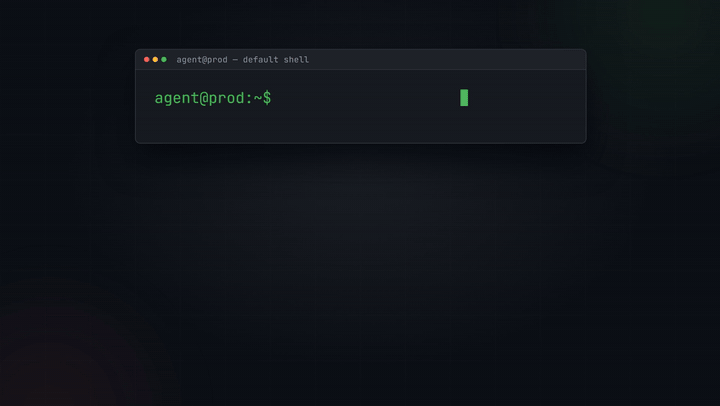

<div align="center">


# Scyvera

**Set the boundary once. Get it enforced everywhere. Prove it forever.**

Operational contracts for AI agents: what a system can do, what it can access, and what it must never do — enforced at runtime and provable after the fact.

MCP and A2A standardize how agents communicate with tools and each other. Scyvera defines the layer above: the operational boundary those agents run inside.

[](./LICENSE)
[](https://github.com/Skull-boy/agent-contracts/actions/workflows/validate-contracts.yml)
[](https://pypi.org/project/scyvera/)
[](https://pepy.tech/projects/scyvera)
[](pyproject.toml)
[](#-install-and-platform-support)
[](./SECURITY.md)
[](#-the-2-minute-demo)
</div>

---

> **Try it, read nothing first:** `pip install scyvera && scyvera audit .`
>
> **Version status:** PyPI `1.3.0` ships the audit funnel, Blast Radius report, contract drafts, and Policy Packs. `main` — the next release — adds the hash-chained registry, contract identity pinning, the re-seal ritual, conformance tiers, v1.2 guardrails, `scyvera self-check` with signed release attestations, the trace-driven eval harness, and the unified report format (`scyvera.unified`) with the `scyvera eval` command plus additive `--unified` output on `check` and `audit`.

---

## ⚡ The 2-Minute Demo

**Scyvera in 23 seconds** — the audit, the generated draft, and the block that proves it:



And this is `scyvera audit .` run inside the Scyvera repository itself:

```text
WARN  .
      Blast Radius: 92/100 (Shielded)

      MEDIUM    [AU-N8N-001] n8n workflow with external writes
                implementations/n8n/competitor-feature-parity-watcher/workflow.json:169 + 3 more
      MEDIUM    [AU-NET-002] outbound network calls in source
                implementations/langgraph/duplicate-issue-detector/backfill.py:23 + 1 more

      With a contract: force-push -> requires approval; .env -> unread;
      npm publish -> forbidden.  Run with --generate to draft one.
```

The scan is read-only. It did not change a file.

**You never have to write a contract. The scan writes your first draft.**

### a. Scan anything

```bash
scyvera audit <path>
```

Bands from RFC 0004 §4:

| Band | Score | Interpretation |
|---|---|---|
| **Shielded** | 90–100 | Few or no scored findings; the scanned boundary is narrow. |
| **Controlled** | 70–89 | Some findings; the boundary is mostly declared, with gaps to review. |
| **Exposed** | 40–69 | Multiple or high-severity findings; the environment can do more than it declares. |
| **Unbounded** | 0–39 | Critical or broad findings; little enforceable boundary is present. |

A band summarizes a scan. It is not a security certification.

### b. Put a badge in your README

```bash
scyvera audit . --badge
```

Alongside the report, it prints the snippet below. This repository's own badge is in the hero row above.

```markdown
[](scyvera)
```

### c. Gate CI

```bash
scyvera audit . --fail-under 90
```

Exit codes: `0` ok, `1` findings or threshold breach, `2` usage or I/O error.

One GitHub Actions step:

```yaml
- run: scyvera audit . --fail-under 90
```

### d. Adopt the boundary it found

```bash
scyvera audit . --generate contract.yaml
```

```text
Draft contract written to contract.yaml (validate with: scyvera validate contract.yaml).
```

The scan writes one schema-valid v1.1 contract. `scyvera validate contract.yaml` and `scyvera lint contract.yaml` both pass with 0 warnings, and a permanent fixture sweep enforces that for every audit corpus. `--force` overwrites an existing file; nothing else is ever written.

That draft is the input to the enforcement layer below: `ContractEnforcer.load("contract.yaml")` turns the scanned boundary into a runtime gate.

### e. Start from a policy, not a blank page

```bash
scyvera audit . --generate contract.yaml --pack github-safe
```

The pack's constraints win over heuristic-derived entries; finding-only extras are appended. Six golden packs ship in `packs/`: `dev-agent`, `github-safe`, `finance-ops`, `research-assistant`, `email-triage`, `devops-safe`. Loading is local-only. A pack is a starting boundary, not an audit result. See [`docs/policy-packs.md`](./docs/policy-packs.md).

---

## 💻 Install and Platform Support

```bash
pip install scyvera

# Optional adapters, only if you use the gated gateways
pip install "scyvera[github]"     # PyGithub
pip install "scyvera[qdrant]"     # qdrant-client
pip install "scyvera[all]"        # both
```

Scyvera is a pure-Python wheel (`py3-none-any`): no compiler, no native extension, no OS-specific build step.

| Platform | Status | Notes |
|---|---|---|
| **Windows 10/11** | ✅ tested in CI | Narrow-console safe: the report falls back from `—` to `->` on cp437/cp850. Symlink tests skip where the OS denies link creation. |
| **Linux** | ✅ tested in CI | `ubuntu-latest`, all supported Python versions. |
| **macOS** | ✅ tested in CI | `macos-latest`, all supported Python versions. |
| **Python** | ✅ 3.10 – 3.14 | 15-cell matrix: 3 operating systems × 5 Python versions, `fail-fast: false`. |

From a checkout instead:

```bash
git clone https://github.com/Skull-boy/agent-contracts.git
cd agent-contracts
pip install -e ".[dev]"
scyvera audit .
```

### Verify the installed distribution

The command that makes an install self-checking:

```bash
scyvera self-check
```

```text
PASS  self-check  scyvera 1.3.0
      manifest: 1
      verified: 26 files
```

`self-check` verifies the **installed** package — never the current directory — against the `_self_manifest.json` shipped inside the wheel. It resolves the package through `importlib.resources`, cross-checks the manifest version against installed distribution metadata, and fails closed:

- a **modified** runtime file (any byte change) fails and is named;
- a **missing** listed file fails;
- an **unlisted addition** fails — a dropped-in module override is tampering surface (T5-consistent);
- a missing, malformed, or unsupported manifest is **unverifiable**, not silently OK.

Exit codes are deliberate:

| Code | Meaning |
|---|---|
| `0` | Every listed file matches; no unlisted additions. |
| `1` | A verifiable manifest disagrees with the installed files, or manifest/installed versions differ. |
| `2` | Unverifiable: missing/malformed/unsupported manifest, or an IO/installed-distribution problem. A pre-manifest install is `2`, not `1`. |

Machine-readable output:

```bash
scyvera self-check --json
```

The JSON report is `self_check_version: 1` and uses the same conventions as the audit report (deterministic, no timestamps).

### Signed releases and the attestation bundle

Every tag release is attested with Sigstore build provenance. The release page carries:

| Artifact | What it proves |
|---|---|
| `scyvera-<version>-py3-none-any.whl` | The exact wheel published to PyPI. |
| `scyvera.cdx.json` | A deterministic CycloneDX **1.5** SBOM: scyvera, its declared runtime dependencies, and optional `pydantic` when present. |
| `release-manifest.json` | RFC 0003 §C6 bundle binding `{wheel_hash, schema_version, adapter_floors, self_check_manifest}`. |

The attested wheel is the published wheel **by construction**: the attestation workflow downloads the completed publish run's `dist` artifact instead of rebuilding, installs that wheel in a clean venv, regenerates the self manifest from the installed tree, runs `scyvera self-check` as a gate, and signs the result. It never attests bytes that were not uploaded.

Verify a download yourself:

```bash
gh attestation verify dist/scyvera-<version>-py3-none-any.whl \
  --repo Skull-boy/agent-contracts
```

---

## 🔍 Conformance: Check What the Code Actually Does

`scyvera check` implements the RFC 0003 §C3 tiers. Tier 0 is a strict superset of `validate` + `lint`; Tier 1 inspects implementation source against the declared contract.

```bash
# Tier 0 — structural: schema errors + ACxxx semantic warnings in one report
scyvera check contract.yaml

# Tier 1 — static: an n8n workflow or LangGraph implementation directory
scyvera check implementations/n8n/duplicate-issue-detector --tier 1
scyvera check implementations/langgraph/duplicate-issue-detector --tier 1
```

```text
FAIL  implementations/n8n/duplicate-issue-detector/contract.yaml (tier 1 (static): 2 tier-1 finding(s))
      [T101] undeclared action: node 'Embed New Issue (Ollama)' reaches 'local-llm' ...

WARN  implementations/langgraph/duplicate-issue-detector/contract.yaml (tier 1 (static): 6 tier-1 finding(s))
      [T103] unused declaration: contract declares a permission for 'github.close' ...
```

The n8n reference intentionally reports `T101` for its two Ollama endpoints; the LangGraph reference is `T103`-only, which is warn-only and exits `0`. Both behaviours are pinned in `tests/test_tier1_n8n.py` and `tests/test_tier1_langgraph.py`.

Tier behaviour is explicit, never silent:

- `--tier auto` (default) resolves to the highest implemented tier and prints a `note:` saying which one it chose.
- `--tier 1` dispatches to the adapter that claims the target (n8n workflow JSON or LangGraph Python source). An unclaimed target exits `2` with one actionable line.
- `--tier 2` (runtime trace) is reserved and fails loudly with exit `2` until the trace adapter ships. That adapter is the `check --tier 2` surface only: the runtime trace and eval engine itself shipped in M2.4/M2.5, and `scyvera eval` already runs four-axis scoring over governed agents.

Tier 1 finding taxonomy:

| Code | Severity | Meaning |
|---|---|---|
| `T101` | error | **Undeclared action** — the implementation reaches an external service the contract does not declare. |
| `T102` | error | **Ungated call** — a write-capable path is reachable from a trigger without traversing a declared approval gate. |
| `T103` | warning | **Unused declaration** — the contract declares something the implementation never exercises. Additive symmetry, never fails a check on its own. |

Exit codes: `0` pass (or warn-only), `1` a T101/error-severity T102, `2` usage/IO or an unavailable tier.

The adapters never import or execute the target: n8n is parsed as JSON, LangGraph as Python `ast`. Unknown externally-reaching node types, unknown hosts, and unparseable source fail closed as findings rather than being skipped.

### Eval scoring (`scyvera eval`)

An eval case is a YAML file naming a contract, a scenario, and the expected trace. The harness runs the case's reference agent through a `ContractEnforcer`, records the RFC 0003 §C4 trace, and scores four axes.

```bash
scyvera eval implementations/langgraph/duplicate-issue-detector/evals/refund-agent.eval.yaml
```

```text
WARN  refund-agent
      total: 75.0/100
      constraints: 0.0
      approval: 1.0
      recovery: 1.0
      replay: 1.0
      trace: 4 entries
```

The total is `100 × Σ(weight × axis)`; this fixture deliberately attempts one undeclared action, so `constraints` is `0.0` and the case reports `WARN`. A matching run is a measurement, not a certification. Warnings, when a run records any, print as `[EVAL]` lines below the axes. `--json` emits the unified report envelope; `check` and `audit` gain additive `--unified` flags with the same envelope, and their existing `--json` outputs stay byte-identical. Exit codes: `0` pass/warn, `1` fail, `2` usage/IO. Case format and scoring details: [`docs/evals.md`](./docs/evals.md).

---

## 🛡️ Governing for Real

Scanning shows what the environment can do. This section turns that into enforcement: the draft from step 2d is a normal v1.1 contract, so it loads into the enforcer, and the registry makes the boundary provable after the fact.

Scyvera provides complementary governance layers:

| Layer | Component | Responsibility | Trust Level |
|---|---|---|---|
| **Tier 0: Structural** | `validate_contract()`, `lint_contract()` | Validates that `contract.yaml` is structurally and semantically well-formed against JSON Schemas and the ACxxx rules. | Declaration conformance |
| **Tier 1: Static** | `check_contract()`, `Tier1Adapter` | Compares exercised services and approval paths in n8n/LangGraph code against the contract. | Static conformance |
| **Tier 2 groundwork** | `scyvera.evals` runner + `scyvera eval` CLI + the unified report envelope (`scyvera.unified`) | Runtime trace scoring: four-axis eval (constraints, approval, recovery, replay) over governed agent runs, projected into the same envelope as audit and check. | Measured conformance |
| **Runtime Enforcement** | `ContractEnforcer` (`load()`, `from_declaration()`) | Gates Python calls against declared permissions and side effects with **Default-Deny**; interrupts at approval boundaries; seals contracts with SHA-256. | Execution boundary |
| **Identity Pinning** | `ContractIdentity`, `verify_integrity()` | Pins the canonical path and load-time hash, refuses symlink escapes, and detects post-load path swaps. | Substitution defense (T5/T12/T14) |
| **Gateway Isolation** | `BaseGateway`, `GitHubGateway`, `QdrantGateway` | Holds credentials privately and gates every external API call, structurally preventing gate bypass. | Credential & API isolation |
| **Provenance Registry** | `ContractRegistry`, `RegistryEntry` | Append-only, hash-chained, versioned store. Answers what contract governed which agent at any historical moment. | Cryptographic provenance (T13) |
| **Re-seal Ritual** | `reseal()` | The only sanctioned regeneration path: validate → lint → re-register → fresh sealed enforcer, with an audit record. | Authoring integrity (T12) |
| **Distribution Integrity** | `self_check()`, release attestation | Verifies the installed runtime files against the signed manifest and binds the wheel to Sigstore provenance + SBOM. | Install integrity (T11) |

### Contract CLI

Create a starter contract, or inspect one you already have. The CLI detects the specification version (`1` vs `1.1`) and validates against the matching JSON Schema.

```bash
scyvera init contract.yaml --name "Research Assistant" --domain "research"
scyvera validate contract.yaml
scyvera lint contract.yaml
scyvera check contract.yaml
scyvera serve-mcp  # MCP server over stdio for agent hosts (see docs/mcp.md)
```

```text
CREATED contract.yaml (spec version 1.1)
PASS  contract.yaml
PASS  contract.yaml (0 semantic warnings)
PASS  contract.yaml (tier 0 (structural): 0 schema errors, 0 semantic warnings)
```

`lint` runs the Tier 2 ACxxx rules: unbounded write permissions (AC101), high-risk systems without approvals (AC201), vague idle behavior (AC301), and irreversible actions without an approval boundary (AC302).

`check` runs the conformance tiers described above. Use it in CI in place of the two separate commands when you want one auditor-readable report.

### Runtime Enforcer

The `ContractEnforcer` protects your agent's execution boundaries in Python by enforcing **Default-Deny**: any undeclared permission or side effect raises `ContractViolationError`, and any action requiring approval raises `ApprovalPendingError`.

#### File-based contract gating

```python
from scyvera import ContractEnforcer, ContractViolationError, ApprovalPendingError

# 1. Load, validate, pin identity, and freeze contract.yaml from disk
enforcer = ContractEnforcer.load("implementations/n8n/duplicate-issue-detector/contract.yaml")

# 2. Gate sensitive tools and operations
@enforcer.gate(action_name="github:issues:write", action_type="permission")
def post_github_comment(issue_id: int, comment: str):
    print(f"Posting comment to issue #{issue_id}: {comment}")
    return True

@enforcer.gate(action_name="aws_s3:read", action_type="permission")
def read_s3_bucket():
    return "s3_data"

# 3. Allowed calls execute cleanly and log to the audit trail
post_github_comment(101, "Potential duplicate detected.")

# 4. Undeclared actions are denied immediately (Default-Deny)
try:
    read_s3_bucket()
except ContractViolationError as e:
    print(f"Blocked by Scyvera: {e}")

# 5. Inspect the immutable audit log
for entry in enforcer.get_audit_log():
    print(f"[{entry.timestamp}] {entry.decision} - {entry.action_name} ({entry.reason})")

# 6. Verify file integrity on disk (T5/T14 defense)
enforcer.verify_integrity()  # raises on modification or a post-load symlink swap
```

The pinned identity is available for inspection:

```python
identity = enforcer.contract_identity
print(identity.canonical_path)      # resolved once at load time (None for declarations)
print(identity.load_hash)           # SHA-256 of the sealed contract
print(identity.resolved_symlink)    # True if a symlink was walked at/below the addressed dir
print(identity.crosscheck)          # matches-registry / stale-registry / unregistered / ...
```

#### Dynamic runtime declarations (no YAML file required)

For agents created dynamically at runtime, Scyvera supports code-declared contracts with the same enforcement guarantees:

```python
from scyvera import ContractEnforcer, DeclarationValidationError

# Declare the contract directly in Python — sealed cryptographically at creation
enforcer = ContractEnforcer.from_declaration({
    "node_id": "researcher-v1",
    "permissions": ["arxiv:read", "database:read"],
    "side_effects": ["database:write"],
    "approval_points": ["database:write"],
    "lifecycle": "request-response",
    "state": "stateless",
})

print(f"Sealed SHA-256 Digest: {enforcer.integrity_hash}")
print(f"Contract Source: {enforcer.contract_source}")  # 'declaration'

# Enforces identical default-deny rules
@enforcer.gate("arxiv:read", "permission")
def fetch_papers(topic: str):
    return ["paper1", "paper2"]

fetch_papers("quantum computing")  # Executes and logs to the audit trail
```

### Gateway Enforcement Architecture

In agent architectures, security boundaries fail if agents can bypass enforcers by importing and calling raw API clients directly. Scyvera solves this with **Gateways** (`BaseGateway`, `GitHubGateway`, `QdrantGateway`):

- **Single Enforcement Boundary**: API credentials and raw SDK clients (e.g. `PyGithub`, `qdrant-client`) are encapsulated privately within the gateway. No outside node holds credentials or raw clients.
- **Structural Gating**: Every public method is decorated per-instance with `@enforcer.gate(...)`. Any undeclared or unapproved action halts execution immediately via `ContractViolationError` or `ApprovalPendingError`.
- **Exception Normalization**: Client exceptions are caught and wrapped into `GatewayError` to ensure deterministic fault isolation.
- **CI Linting**: `.github/workflows/lint-gateway.yml` scans the codebase and fails the build if any raw API client is imported outside `gateway.py`.

Install optional adapters with `pip install "scyvera[github]"`, `pip install "scyvera[qdrant]"`, or `pip install "scyvera[all]"`.

```python
from scyvera import ContractEnforcer, GitHubGateway, GatewayError, ContractViolationError

# 1. Load the contract enforcer
enforcer = ContractEnforcer.load("contract.yaml")

# 2. Instantiate the gateway with an injected enforcer and private credentials
gateway = GitHubGateway(enforcer, token="YOUR_GITHUB_TOKEN")

# 3. Gated read operation (succeeds if declared in the contract)
issue = gateway.read_issue("owner/repo", issue_number=42)

# 4. Gated mutating operation (enforces Default-Deny and approvals)
try:
    gateway.close_issue("owner/repo", issue_number=42)
except ContractViolationError as e:
    print(f"Blocked by Scyvera: {e}")
```

### Contract Registry: Hash-Chained Provenance

The `ContractRegistry` is a versioned, append-only, persistent record of every contract that has governed any agent in your ecosystem. It answers: *"What contract governed this agent at this exact moment, and has that contract ever changed?"*

Every new entry carries `prev_hash`, the SHA-256 of the previous entry's canonical bytes (or a fixed genesis hash). The chain is recomputable from `registry.jsonl` alone, so a break, splice, reorder, edit, or fabricated insertion fails closed — the T13 mitigation.

```python
from scyvera import ContractEnforcer, ContractRegistry

# 1. Initialize a registry backed by a persistent JSON-lines file
registry = ContractRegistry(".scyvera/registry.jsonl")

# 2. Register an agent enforcer (idempotent on duplicate contract hash)
enforcer = ContractEnforcer.from_declaration({
    "node_id": "triage-agent-v1",
    "permissions": ["github:read"],
    "side_effects": ["github:comment"],
})
entry = enforcer.register(registry)

print(f"Registered Version: {entry.version}")
print(f"Registry Entry ID: {entry.entry_id}")
print(f"Integrity Hash: {entry.contract_hash}")
print(f"Chain Link: {entry.prev_hash}")

# 3. Recompute and verify the chain from the file alone
registry.verify_chain()  # raises RegistryError on any break

# 4. Query the latest contract for an agent
latest_entry = registry.get_latest("triage-agent-v1")

# 5. Time-travel audit query: the contract active at an exact historical timestamp
historical_entry = registry.get_at_time(
    node_id="triage-agent-v1",
    timestamp="2026-10-20T12:00:00+00:00",
)

# 6. Inspect the full version history for a node, or for a file contract by path
history = registry.get_history("triage-agent-v1")
file_history = registry.get_history_by_path("contract.yaml")

# 7. Migrate a pre-chain registry explicitly — idempotent, never silent
snapshot = registry.upgrade_chain()  # writes <registry>.prechain; None if already chained
```

Pre-chain files remain readable but refuse new `register()` calls until the explicit `upgrade_chain()` migration. The snapshot sidecar and warning make the historical boundary explicit: backfilled hashes prove integrity from the upgrade moment, not before it.

### Identity Pinning and the Re-seal Ritual

`ContractEnforcer.load()` refuses contracts that escape through symlinks and pins the canonical path at load time. When a contract changes, the supported path is `reseal()` — validate → lint with zero errors → chain-verified register → fresh enforcer, plus a frozen audit record:

```python
from scyvera import reseal, ResealError

try:
    result = reseal("contract.yaml", ".scyvera/registry.jsonl")
except ResealError as error:
    raise SystemExit(f"re-seal refused: {error}")

enforcer = result.enforcer          # a fresh, governable enforcer
record = result.record
print(record.version, record.contract_hash, record.lint_warnings)
```

A skipped or partial registration raises `ResealError` instead of returning a governable enforcer. `allow_unsealed_reseal=True` (default `False`) exists only for test scaffolds and documented dev iteration.

### Programmatic Contract Builder

You can construct, inspect, serialize, and validate Agent Contracts in Python without writing YAML by hand:

```python
from scyvera import Contract, validate_contract

# Programmatically construct a v1.1 Contract
contract = (
    Contract(name="Literature Research Assistant", purpose="Analyzes scientific papers")
    .set_domain("research")
    .add_capability("search_documents", description="Queries research repositories")
    .add_resource("paper_db", type="pdf_repository", access="read")
    .add_input("research_topic", type="string", required=True)
    .add_output("summary", type="document")
    .add_permission("paper_db", actions=["read", "search"])
    .set_state("session")
    .set_recovery("retry")
    .set_replay("idempotent")
    .set_observability("basic")
    .set_risk("low", category="misinformation_risk")
)

# Validate directly in code
result = contract.validate()

if result.valid:
    print("Contract is valid")
    contract.save("contract.yaml")
else:
    for err in result.errors:
        print(f"Error at {err.path}: {err.message}")
```

---

## 🧩 What This Actually Is

`Scyvera` provides a machine-readable specification and Python governance layer for defining and enforcing the operational boundary of intelligent or automated systems.

It is **NOT**:
- another agent framework
- an LLM wrapper
- an orchestration library
- a coding-agent framework
- an OS-level sandbox or anti-malware scanner

It **IS**:
A framework-independent and domain-independent governance layer describing and enforcing system identity, capabilities, resources, inputs, outputs, permissions, constraints, side effects, approvals, dependencies, state persistence, failure recovery, replay semantics, observability, and risk — with distribution integrity you can verify after install.

---

## ⚠️ What Scyvera Does Not Guarantee

Scyvera provides structural verification, static conformance, runtime gating, gateway isolation, chained provenance, and install-integrity checks. Security is still an end-to-end discipline:

1. **Gate bypass at call sites (T4)**: enforcement happens at `@enforcer.gate(...)`. Use the **Gateways** so credentials and raw SDK clients stay private, and call `ContractEnforcer.assert_gated(fn)` in integration tests for custom functions.
2. **Internal third-party behaviour / string spoofing (T6)**: Scyvera verifies that a declared intent (e.g. `github:issues:write`) matches an allowed permission. It does not do bytecode analysis or packet inspection to prove that a third-party library makes no unauthorised background calls.
3. **Pre-load file tampering (T5)**: `verify_integrity()` catches replacement after load. It cannot prove that a tampered `contract.yaml` was clean before it was loaded; that is what the registry cross-check, identity pinning, and the re-seal ritual are for.
4. **Install integrity is not sandboxing (T11)**: `self-check` detects changes to the installed `scyvera` package after install, and Sigstore attestation proves which wheel was built and published. Neither verifies your Python interpreter, your site-packages as a whole, or code you installed beside Scyvera. Optional extras execute their own dependencies.
5. **The manifest is only as trustworthy as its delivery**: an attacker who can rewrite both the package files and the manifest on disk can make `self-check` pass. The root of trust is the signed release attestation, not the manifest alone.

Threat models: [`docs/threat-model-lifecycle.md`](./docs/threat-model-lifecycle.md), [`docs/threat-model-enforcer.md`](./docs/threat-model-enforcer.md), [`docs/threat-model-distribution.md`](./docs/threat-model-distribution.md).

---

## 🌐 Domain-Neutral Example Contracts (v1.1)

See [`examples/v1.1/`](./examples/v1.1) for runnable, validated v1.1 contracts across different domains. `scyvera audit --generate` produces drafts in this same v1.1 schema, so generated and hand-authored contracts share one format.

| Domain | Contract File | Description |
|---|---|---|
| **Education** | [`education-tutor.yaml`](./examples/v1.1/education-tutor.yaml) | Guided study tutor, low risk, session state |
| **Research** | [`research-assistant.yaml`](./examples/v1.1/research-assistant.yaml) | Scientific literature analysis, arXiv API dependency |
| **Finance** | [`financial-operations.yaml`](./examples/v1.1/financial-operations.yaml) | Critical risk, payment caps ($5000 USD limit), controller approval gate |
| **Healthcare** | [`clinical-information-assistant.yaml`](./examples/v1.1/clinical-information-assistant.yaml) | High risk, EHR database access, physician approval gate, model integrity requirements |
| **Business automation** | [`business-automation.yaml`](./examples/v1.1/business-automation.yaml) | Back-office workflow with declared side effects |
| **Software development** | [`software-development-agent.yaml`](./examples/v1.1/software-development-agent.yaml) | Coding agent with repository and CI boundaries |

---

## 📚 Documentation Map

| Document | What it answers |
|---|---|
| [`WORKFLOW-CONTRACT-SPEC.md`](./WORKFLOW-CONTRACT-SPEC.md) | The formal field reference for v1 and v1.1 contracts. |
| [`docs/contract-model-v1.1.md`](./docs/contract-model-v1.1.md) | Normative v1.1 specification model. |
| [`docs/contract-reference.md`](./docs/contract-reference.md) | Field-by-field cheat sheet. |
| [`docs/design-principles.md`](./docs/design-principles.md) | The normative design principles behind the model. |
| [`docs/architecture.md`](./docs/architecture.md) | Repository layers and module responsibilities. |
| [`docs/roadmap.md`](./docs/roadmap.md) | Task-level implementation plan and shipped notes. |
| [`docs/policy-packs.md`](./docs/policy-packs.md) | Policy Pack format, merge semantics, and how to add one. |
| [`docs/evals.md`](./docs/evals.md) | Trace-driven eval case format, agent factory, and the four scoring axes. |
| [`docs/mcp.md`](./docs/mcp.md) | MCP server mode: host configuration, the five tools, and the scope note. |
| [`docs/terminology.md`](./docs/terminology.md) | Shared vocabulary. |
| [`docs/vision.md`](./docs/vision.md) | Strategic direction. |
| [`docs/workflow-engineering.md`](./docs/workflow-engineering.md) | Engineering philosophy. |
| [`docs/concepts/`](./docs/concepts) | Deep dives: approvals, permissions, recovery, replay, side effects. |
| [`docs/spec/contract-v1.1-design.md`](./docs/spec/contract-v1.1-design.md) | v1.1 design record. |
| [`rfcs/`](./rfcs) | Permanent numbered decision records (RFC 0002–0004). |
| [`SECURITY.md`](./SECURITY.md) | Supported versions and coordinated disclosure. |

---

## 📂 Repository Structure

```text
agent-contracts/
├── README.md                           # This file
├── WORKFLOW-CONTRACT-SPEC.md           # Formal specification (v1 and v1.1)
├── CHANGELOG.md                        # Version history and releases
├── CONTRIBUTING.md                     # Contribution guidelines and testing
├── CONTRIBUTORS.md                     # Project contributors
├── SECURITY.md                         # Supported versions and disclosure policy
├── LICENSE                             # MIT License
├── pyproject.toml                      # Build, packaging, dependencies, test config
├── requirements-dev.txt                # Development dependencies
├── .gitguardian.yaml                   # Scanner exclusion for synthetic audit fixtures
├── .github/workflows/
│   ├── lint-gateway.yml                # Fails on raw API client imports outside gateway.py
│   ├── publish-pypi.yml                # Tag-triggered wheel build, dist upload, PyPI publish
│   ├── release-attest.yml              # Sigstore attestation, SBOM, release manifest
│   └── validate-contracts.yml          # 15-cell OS × Python test matrix and wheel verification
├── assets/                             # Logo and demo assets
├── docs/
│   ├── architecture.md                 # Repository layers and module roles
│   ├── contract-model-v1.1.md          # Normative v1.1 specification model
│   ├── contract-reference.md           # Contract field reference cheat sheet
│   ├── design-principles.md            # Normative design principles
│   ├── evals.md                        # Trace-driven eval format and scoring
│   ├── policy-packs.md                 # Policy Pack format and merge rules
│   ├── roadmap.md                      # Implementation roadmap and shipped notes
│   ├── terminology.md                  # Specification terminology
│   ├── threat-model-enforcer.md        # Runtime threat model (T4–T10)
│   ├── threat-model-distribution.md    # Distribution threat model (T11–T14)
│   ├── threat-model-lifecycle.md       # Lifecycle threat model (T1–T3)
│   ├── vision.md                       # Strategic project vision
│   ├── workflow-engineering.md         # Engineering philosophy
│   ├── concepts/                       # Approval, permission, recovery, replay, side-effect deep dives
│   └── spec/                           # v1.1 design record
├── examples/
│   ├── tamper_demo.py                  # Integrity-check demonstration
│   └── v1.1/                           # Validated v1.1 domain examples
├── patterns/                           # Reusable contract patterns
├── packs/                              # Six golden Policy Packs (RFC 0004 §6)
├── rfcs/                               # Numbered specification and architecture RFCs
├── schemas/                            # JSON Schemas (v1, v1.1, and v1.2)
├── scripts/
│   └── validate_contracts.py           # Repository-wide contract validation
├── src/scyvera/                        # Python governance package
│   ├── __init__.py                     # Public API exports
│   ├── _self_manifest.json             # Signed package-file manifest (RFC 0003 §C2)
│   ├── audit.py                        # Deterministic audit scan engine
│   ├── audit_rules.py                  # AUxxx rule registry and suggestions
│   ├── builder.py                      # Programmatic Contract Builder API
│   ├── chain.py                        # Pure hash-chain mechanics (RFC 0003 §C1)
│   ├── cli.py                          # CLI: validate, lint, check, self-check, audit, eval, init
│   ├── conformance.py                  # Tier 0/1 conformance engine and T101–T103
│   ├── enforcer.py                     # Runtime enforcer, identity pinning, dynamic declarations
│   ├── exceptions.py                   # Exception hierarchy
│   ├── gateway.py                      # Gated gateway layer (base, GitHub, Qdrant)
│   ├── generate.py                     # Schema-valid contract draft generator
│   ├── guardrails.py                   # v1.2 guardrails: budgets, rate windows, fail-closed
│   ├── linter.py                       # Tier 2 semantic linter (ACxxx)
│   ├── packs.py                        # Policy Pack loader and validation
│   ├── packs/                          # Packaged Policy Packs (wheel data)
│   ├── registry.py                     # Versioned, hash-chained contract registry
│   ├── report.py                       # Band-first Blast Radius renderer and badge
│   ├── reseal.py                       # M1.4 re-seal ritual
│   ├── selfcheck.py                    # Package self-integrity engine (RFC 0003 §C2)
│   ├── trace.py                        # RFC 0003 §C4 execution trace and JSONL
│   ├── unified.py                      # Unified report envelope; projections for audit/check/eval (M2.5)
│   ├── validator.py                    # Multi-version schema validation engine
│   ├── evals/                          # Trace-driven eval harness (M2.4)
│   └── schemas/                        # Bundled schemas (v1, v1.1, and v1.2)
├── tools/                              # Release tooling (stdlib-only)
│   ├── generate_self_manifest.py       # Writes the canonical self manifest
│   ├── generate_sbom.py                # Deterministic CycloneDX 1.5 SBOM
│   └── build_release_manifest.py       # RFC 0003 §C6 attestation bundle
├── tests/                              # 33 test files: conformance, evals, trace, enforcer, audit, report-shape pins
│   └── fixtures/                       # Validator fixtures and audit corpus
└── implementations/                    # Multi-framework reference implementations
    ├── n8n/duplicate-issue-detector/        # Tier-1 reference (T101 sample pinned)
    ├── langgraph/duplicate-issue-detector/  # Tier-1 reference (AST adapter; golden eval fixture)
    └── rfcs/                                # Adapter-floor RFCs for implementations
```

---

## 🗺️ Implementation Status & Roadmap

### Available Now

- **Agent Contracts v1 & v1.1 Specifications**: schemas and field references for identity, capabilities, permissions, constraints, side effects, approvals, dependencies, lifecycle, recovery, replay, observability, and risk. A v1.2 slice adds an optional `guardrails` object (fail-closed, per-window side-effect budgets, and per-minute rate limits) as a strict superset of v1.1.
- **Audit funnel (`scyvera audit`)**: deterministic AUxxx scan, band-first **Blast Radius** report, `--badge`, `--fail-under`, `--generate` drafts, and `--pack` Policy Packs.
- **Conformance tiers (`scyvera check`)**: Tier 0 structural superset of `validate` + `lint`; Tier 1 static adapters for **n8n** and **LangGraph** with `T101`/`T102`/`T103` findings. Tier 2 (runtime trace) is reserved and fails loudly.
- **Execution traces and evals (`scyvera.trace`, `scyvera.evals`)**: lossless `AuditEntry` ↔ RFC 0003 §C4 trace conversion with canonical JSONL, and a deterministic four-axis eval harness (constraints, approval, recovery, replay) driven by fail-closed YAML cases.
- **Static validation and lint**: CLI and Python API (`validate_contract`, `lint_contract`) across both schema versions.
- **Runtime enforcement**: default-deny `ContractEnforcer`, approval boundaries, immutable audit trails, dynamic declarations, and post-load integrity checks.
- **Identity pinning**: canonical-path pinning, symlink-escape refusal, post-load path-swap detection, and optional registry cross-checks.
- **Gated gateways**: `BaseGateway`, `GitHubGateway`, `QdrantGateway`, with CI enforcement that raw clients stay inside `gateway.py`.
- **Hash-chained registry**: `prev_hash` on every entry, `verify_chain()`, explicit `upgrade_chain()` migration, and point-in-time / per-path history queries.
- **Re-seal ritual**: `reseal()` is the only sanctioned regeneration path and returns a fresh sealed enforcer plus a frozen audit record.
- **Distribution integrity**: `scyvera self-check [--json]`, a signed package manifest, CycloneDX 1.5 SBOMs, and Sigstore-attested release bundles.
- **Production trust surface**: `SECURITY.md`, SHA-pinned GitHub Actions, least-privilege workflow permissions, a safe-YAML pin, and a **Windows / Linux / macOS × Python 3.10–3.14** test matrix.
- **Permanent dogfood gate**: the test suite asserts that `scyvera audit .` keeps this repository in the `Shielded` band.

### Roadmap

The full task-level plan lives in [`docs/roadmap.md`](./docs/roadmap.md). Current state:

- **Phase 1 — Core Hardening**: shipped — hash-chained registry (M1.1), trace schema (M1.2), contract identity pinning (M1.3), and the re-seal ritual (M1.4). Remaining: threat-model doc status refresh (M1.5).
- **Phase 2 — Conformance & Evals**: Tier 0 CLI (M2.1), n8n adapter (M2.2), LangGraph adapter (M2.3), trace-driven eval harness (M2.4), the unified report format (M2.5), the additive v1.2 guardrails slice (M2.6), and Policy Packs (M2.7) shipped. **Phase 2 is complete.** Next lane: the official `scyvera-audit-action` (PD-6), `scyvera mcp` server mode (PD-7), the `scyvera-harness` skill (M3.1), and per-target packaging (M3.2).
- **Phase 3 — Distribution**: Sigstore + SBOM attestation (M3.3) and `scyvera self-check` (M3.4) shipped. Remaining: `scyvera-harness` skill (M3.1), multi-runtime packaging for OpenCode / Claude / Gemini / Codex (M3.2), and the documentation surface upgrade (M3.5).
- **Production-Defensibility Program**: PD-1 through PD-4 shipped. Remaining: published benchmark (PD-5), `scyvera-audit-action` (PD-6), `scyvera mcp` server (PD-7), and the deferred Rust scanner (PD-8).
- **Growth lane**: G1 (this README) shipped; G2 launch film rendered and publication pending; G3 showcase gallery and G4 contributor ladder planned.
- **Phase 4 — Optional enforcer upgrades**: sliding-window invocation throttling, asynchronous approval channels, and multi-agent contract negotiation.

---

## 🧪 Running Tests

```bash
pytest tests/ -v
```

The suite currently collects **688 tests**: 682 pass, and 6 symlink tests skip on platforms that forbid link creation. CI runs the same suite across **Windows, Linux, and macOS** on **Python 3.10 through 3.14**.

Two repo-level gates run inside the suite:

- **Dogfood**: `scyvera audit .` must keep this repository in the `Shielded` band (currently 92/100).
- **Draft accuracy**: every audit fixture corpus is drafted, written, re-read from disk, and re-validated with zero schema errors and zero lint warnings.

The release workflows are checked by construction: every action is pinned by full commit SHA, and the attested wheel is downloaded from the publish run rather than rebuilt.

---

## 🤝 Contributing

Contributions are welcome — new domain profiles, framework reference implementations, specification RFCs, audit rules, or Python API improvements. See [CONTRIBUTING.md](./CONTRIBUTING.md) for the full workflow, and [SECURITY.md](./SECURITY.md) for vulnerability disclosure.

Good first contributions: a Policy Pack — start from the template in [`docs/policy-packs.md`](./docs/policy-packs.md); a domain example; or an audit rule with fixtures.

---

## 📄 License

Distributed under the MIT License — see [LICENSE](./LICENSE) for details.

Maintained by [Shinjan Das](https://github.com/Skull-boy) and open-source contributors — see [CONTRIBUTORS.md](./CONTRIBUTORS.md).
